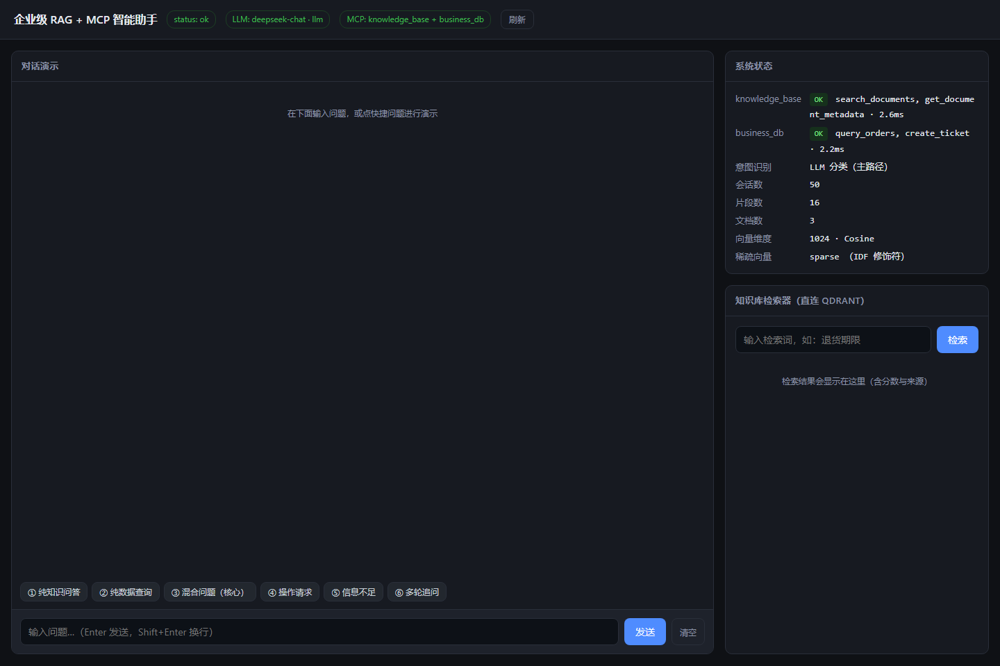
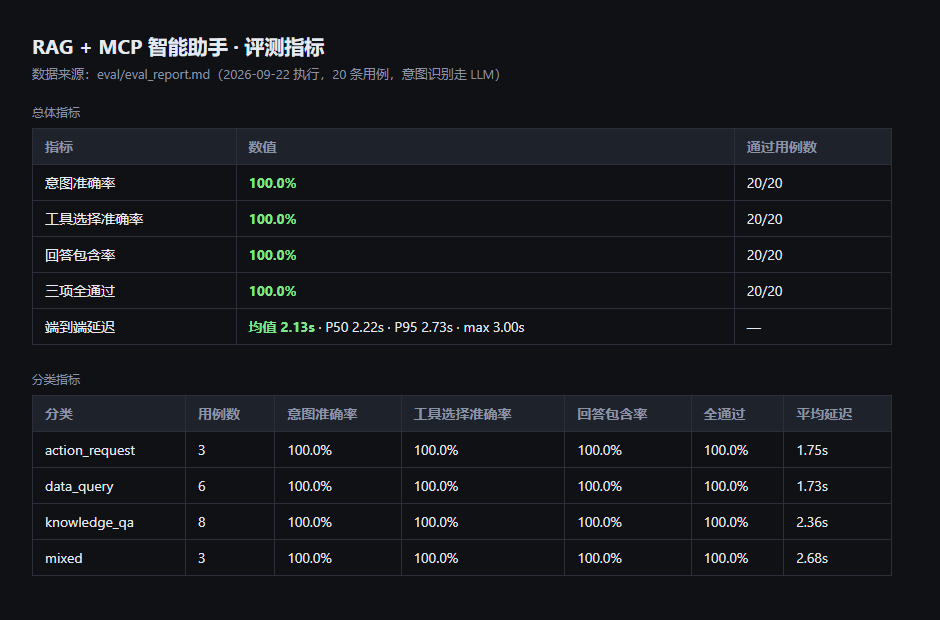
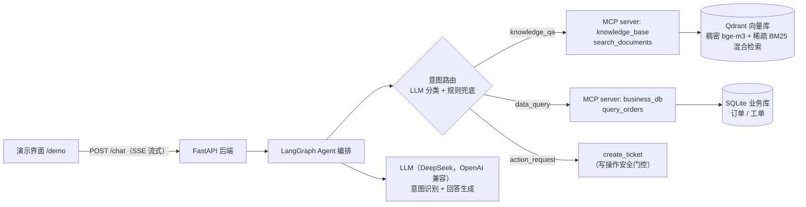

# Enterprise-Rag-MCP-agent

**企业级 RAG + MCP 智能助手**：让 AI 回答「有据可依」，让 Agent「真能查、真能写」——知识问答与业务操作一体化的智能助手中台。



> 作者：宋昊轩 · 许可证：[MIT](LICENSE)

---

## 1. 这是什么 / 解决什么问题

企业内部客服每天要回答两类问题：一类要**翻制度文档**（"退货政策是什么？"），
一类要**查业务系统**（"订单 ORD-001 状态是什么？"），还有一类要**动手操作**
（"帮我建个工单"）。

传统做法是三个系统来回切：查文档、查订单库、手工建工单。这个助手把三件事
**装进一次对话**：

> 客户问一句「订单 ORD-001 符合退货政策吗？」，系统**同时**完成两件事——
> 查业务库拿到订单事实（已签收、金额 299 元），翻政策文档拿到制度依据
> （无理由退货 7 天、定制商品不退…），最后给出**带来源引用**的结论，
> 而不是让大模型凭记忆"编"一个答案。

**一句话概括**：RAG 负责「说得对」，MCP 负责「做得成」，LangGraph 负责把
"想清楚 → 查得到 → 写得出"编排成一条可控的流水线。

## 2. 能做什么

| 能力 | 说明 | 截图 / 验证 |
| --- | --- | --- |
| 🧠 混合问答 | 一句话同时触发「查订单 + 查政策」，回答附**来源引用与相关度** | [截图](docs/images/02-mixed-question.png)（来源《sample_退货政策.md》相关度 0.851） |
| 📊 业务数据查询 | 按客户/订单号/状态/日期区间查订单，输出结构化表格 | [截图](docs/images/03-data-query.png) |
| ✍️ 写操作 + 安全门控 | 「帮我建工单」真实落库并返回工单号；疑问句（"必须填哪些信息"）**只讲解、不落库**，防止误建单 | [截图 04](docs/images/04-write-gate.png)（门控）/ [截图 05](docs/images/05-write-ticket.png)（真实建单 TKT-…） |
| 🔍 可解释的工具链 | 每个回答都展示：识别出的意图 → 执行计划 → 每个工具的耗时与成败 → 引用来源 | 见各截图底部 meta 区 |
| 📈 可复现评测 | 20 条用例覆盖四类意图，一键重跑出报告 | 见[第 6 节](#6-如何复现评测)与 `eval/eval_report.md` |

## 3. 实测效果

数据来源：`eval/eval_report.md`（执行时间 2026-09-22，20 条用例，意图识别走 LLM）。

| 指标 | 结果 | 数据来源文件 |
| --- | --- | --- |
| 意图准确率 | **100.0%**（20/20） | eval/eval_report.md §1 |
| 工具选择准确率 | **100.0%**（20/20） | eval/eval_report.md §1 |
| 回答包含率 | **100.0%**（20/20） | eval/eval_report.md §1 |
| 端到端延迟 | 均值 **2.13s** / P50 2.22s / P95 2.73s / max 3.00s | eval/eval_report.md §1 |
| 分类延迟 | 知识问答 2.36s · 数据查询 1.73s · 混合 2.68s · 操作 1.75s | eval/eval_report.md §2 |
| 检索质量（R@3） | **0.875**（8 条查询网格搜索调参后） | docs/DEVLOG.md 阶段2 |



## 3.1 2026-10 生态迁移（已实测完成）

距初版一个月，生态有两处变化**直接影响了可用性**，已修复并复验：

### ① 模型名：`deepseek-chat` → `deepseek-flash`

官方 [V4 公告](https://api-docs.deepseek.com/zh-cn/news/news260424/) 明确旧名
`deepseek-chat` / `deepseek-reasoner` **于 2026-07-24 停用**。实测调用 API 的报错直接给出合法名单：

```
The supported API model names are deepseek-flash, deepseek-v4-pro
```

> 文档里提到的 `deepseek-v4.1-flash` 实测返回 **400** —— 所以**以 API 报错信息为准，不要照抄文档**。

**踩到的坑**：`.env` 里显式写了 `DEEPSEEK_MODEL=deepseek-chat`，环境变量优先级高于
`${DEEPSEEK_MODEL:-deepseek-flash}` 默认值，导致改了配置**却不生效**（`/health` 仍显示旧名）。
教训：同一个值不要在两处可配，`.env` 只放密钥。

### ② 思考模式吃 token 导致空响应（旧 bug 的真根因）

V4 系列**默认开启思考模式**，`completion_tokens` 里有一大块 `reasoning_tokens`。实测：

| 配置 | completion | reasoning | content |
| --- | --- | --- | --- |
| 默认思考 + `max_tokens=16` | 16 | **16** | **空** |
| 默认思考 + `max_tokens=64` | 24 | 22 | "可用" |
| `thinking: disabled` | **1** | 0 | "可用" |

这解释了此前"意图识别偶发返回空内容、退回规则路径"的真正原因。修复：新增
`llm.classification_thinking: false`，意图分类显式传 `{"thinking":{"type":"disabled"}}`，
output token 从 72 降到 **1**。

### ③ MCP 规范升到 `2026-07-28`（暂不迁移，已标注为技术债）

新规范核心是**去会话化**：移除 `initialize` 握手与协议级会话、新增 `server/discover`、
结果必须带 `resultType`（[changelog](https://modelcontextprotocol.io/specification/2026-07-28/changelog)）。
这会让 `mcp_servers/registry.py` 的会话池设计变得不必要。

**决策：暂不迁移**。现 SDK（`mcp 2.2.0`）实现的是 `2025-11-25`，自洽可跑；无状态改造
等于重写阶段 3，性价比低。**主动标注为已知技术债，而不是假装不存在。**

### 迁移后复验（2026-10-19）

```
模型      : deepseek-flash
用例      : 20/20 全通过
四项指标  : 意图 100% / 工具 100% / 包含 100% / 全通过 100%
失败分布  : 无
延迟      : 均值 2.85s / P50 2.78s / P95 4.06s / max 4.44s
```

> ⚠️ **延迟上升 34%（2.13s → 2.85s）是换模型的代价**：新模型在**回答生成**时默认
> 开启思考，质量更好但更慢。后续可做**分级路由**：混合/推理类问题用思考，简单查询
> 关闭思考，兼顾质量与延迟。

## 4. 架构与技术选型



**为什么这么选**：

| 选型 | 理由 |
| --- | --- |
| RAG（bge-m3 + Qdrant 混合检索） | DeepSeek 暂无开放 embedding 接口，本地 bge-m3 可离线；混合检索兼顾语义与关键词，网格搜索后 R@3=0.875 |
| MCP 协议 | 工具即"插件"：知识库、业务库各自独立进程，可插拔、可开关、可用标准协议对接任意新系统 |
| LangGraph | 把「意图 → 计划 → 工具执行 → 回答」做成显式状态图，每一步可观测、可评测、可注入门控 |
| FastAPI + SSE | 流式输出让前端逐字显示；原生 async 与 MCP 异步会话一致 |
| SQLite + 单文件 Qdrant | 无 Docker、无外部依赖，一台 Windows 机器即可完整复现 |

## 5. 快速开始

> 环境：Windows + PowerShell 5.1，Python ≥ 3.10。以下命令均已实测通过。

```powershell
# 1) 安装依赖（首次）
python -m venv .venv
.\.venv\Scripts\python.exe -m pip install -r requirements.txt

# 2) 配置密钥：复制模板并填入 DEEPSEEK_API_KEY（模板见 .env.example）
Copy-Item .env.example .env
#   国内网络注意：.env.example 已内置 HF_ENDPOINT=https://hf-mirror.com，
#   嵌入模型（约 2.3GB）首次会从镜像下载；huggingface.co 直连会超时。

# 3) 启动向量库 Qdrant（本机无 Docker，用单文件二进制；已运行会跳过）
powershell -ExecutionPolicy Bypass -File scripts\start_qdrant.ps1

# 4) 语料入库（docs/ 下 3 篇演示文档 → 16 个片段；可重复执行，增量跳过）
.\.venv\Scripts\python.exe -m rag_pipeline.ingestion_cli --path ./docs

# 5) 一条命令自检（退出码 0 = 全部就绪）
.\.venv\Scripts\python.exe scripts\healthcheck.py

# 6) 启动后端
.\.venv\Scripts\python.exe -m uvicorn backend.main:app --host 127.0.0.1 --port 8000

# 7) 打开演示界面
#    http://127.0.0.1:8000/demo
```

> 配置校验：`.\.venv\Scripts\python.exe -m config.config_loader`
> （`config/settings.yaml` 是唯一配置真源，支持 `${ENV_VAR}` 占位符）。
> 也可以走 Docker 起 Qdrant：仓库根目录附带 `docker-compose.yml`。

## 6. 如何复现评测

前置条件：Qdrant 已启动、语料已入库、`.env` 里配置了 `DEEPSEEK_API_KEY`
（评测的意图识别走 LLM；不配 Key 会退回规则路径，指标口径会不同）。

```powershell
.\.venv\Scripts\python.exe eval\evaluator.py
```

预期结果：约 1 分钟内跑完 20 条用例，**覆盖** `eval/eval_report.md`（含总体指标、
分类指标、逐条结果与失败分析）并更新 `eval/eval_results.json`。
仓库内现存的报告执行于 2026-09-22，四项分类指标均为 100.0%（见第 3 节表格）。

## 7. 关键设计决策

完整过程与证据见 [docs/DEVLOG.md](docs/DEVLOG.md)，这里挑 5 个：

1. **文档标题进检索编码文本** → 分块时把「来源文件名 + 所属标题」拼进编码向量
   （展示仍是干净正文）。遇到的坑：片段"本政策适用于…"不含"退货"二字检索不到；
   改后 R@3 从 0.750 提到 0.875。
2. **写操作独立安全门控** → 意图分类器之外再设 `_is_write_intent` 判定
   （疑问句、询问词一律不执行写操作）。遇到的坑：KB-05「创建工单必须填写哪些信息？」
   曾真的建了单；加门控后 9/9 单测通过，误建单清零。
3. **MCP 会话跨线程桥接必挂** → 首版用「uvicorn 循环 → 线程池 → 注册表循环线程」
   双重桥接，工具调用固定卡满 60s 超时。改为注册表由**第一个发起异步调用的循环接管**
   后，`/chat` 从 240s 超时降到 0.2s。
4. **本地做混合融合，不用服务端 RRF** → 服务端融合会丢弃原始稠密余弦分，
   而「向量分 > 0.75 优先」等规则都依赖原始分。多一次往返，换来完整分数归因。
5. **执行前实体门控** → 查库前先校验参数（订单号/客户 ID/状态），缺参返回
   `MISSING_ARGUMENT` 而不是发起注定失败的调用；过度调用从 6 条清零，
   端到端延迟均值 −17%（2.56s → 2.13s）。

## 8. 已知限制与后续计划

**已知限制**（如实说明）：

- **单机部署**：Qdrant、后端、本地嵌入模型都在一台机器上，未做容器编排与高可用；
  面向演示与个人项目，不适合直接承载生产流量。
- **演示语料规模小**：知识库仅 3 篇文档（16 片段）、业务库仅 7 条订单，均为
  `docs/sample_*.md` 的演示数据。
- **评测规模有限**：20 条用例覆盖四类意图，未做更大规模、更细颗粒的回归集。
- **无用户鉴权**：`/chat` 未加登录/限流，**不要直接暴露公网**。
- **LLM 依赖外部服务**：意图识别与回答生成依赖 DeepSeek API（本地规则路径可兜底
  意图识别，回答质量依赖 LLM）。
- **脚本为 Windows 专用**：`scripts/*.ps1` 按 PowerShell 5.1 兼容写法编写。

**后续计划**：PPTX/PDF 导出、会话内工具调用可视化回放、鉴权与限流、
更大的评测集（含负样本）、接入更多 MCP 工具（日历/邮件/CRM）。

## 9. 目录结构

```
enterprise-rag-mcp/
├── backend/                # FastAPI 服务 + LangGraph Agent 编排 + 会话管理 + 结构化日志
├── rag_pipeline/           # 文档解析 / 分块 / 嵌入 / Qdrant 混合检索与重排
├── mcp_servers/            # 两个 MCP 工具服务：knowledge_base、business_db
├── eval/                   # 评测器 evaluator.py + 用例 test_cases.json + 报告 eval_report.md
├── web/index.html          # 演示用网页界面（对话 + 状态面板 + 直连检索器）
├── scripts/                # 启动与自检脚本（PowerShell 5.1 兼容）
├── config/settings.yaml    # 唯一配置真源
├── docs/                   # 演示语料 sample_*.md、截图 images/、开发记录 DEVLOG.md
├── .env.example            # 环境变量模板（含国内 HF 镜像配置）
├── docker-compose.yml      # 备选：Docker 起 Qdrant
└── requirements.txt
```

## 10. 许可证

[MIT](LICENSE) © 2026 宋昊轩
